# EverGrims Paintings

Sushi bar and kitchen paintings for the [ImageFrame](https://github.com/LOOHP/ImageFrame) plugin, drawn for the
EverGrims Werks server. Every image is 128 px per block, one map per block, so it lands 1:1 on ImageFrame's maps.
Original pixel art, regenerated by `paintings.py` (Python standard library only).

## Commands

Paste one line at a time in Minecraft chat. Width comes before height.

```
/imageframe create bar_cherry_blossom_sake https://raw.githubusercontent.com/Insanetricks91/evergrims-paintings/main/bar_cherry_blossom_sake_1x2.png 2 1 combined
/imageframe create bar_dine_bento https://raw.githubusercontent.com/Insanetricks91/evergrims-paintings/main/bar_dine_bento_1x1.png 1 1 combined
/imageframe create bar_dine_chirashi_miso https://raw.githubusercontent.com/Insanetricks91/evergrims-paintings/main/bar_dine_chirashi_miso_1x1.png 1 1 combined
/imageframe create bar_dine_last_piece https://raw.githubusercontent.com/Insanetricks91/evergrims-paintings/main/bar_dine_last_piece_1x1.png 1 1 combined
/imageframe create bar_dine_maki_ring https://raw.githubusercontent.com/Insanetricks91/evergrims-paintings/main/bar_dine_maki_ring_1x1.png 1 1 combined
/imageframe create bar_dine_nigiri_board https://raw.githubusercontent.com/Insanetricks91/evergrims-paintings/main/bar_dine_nigiri_board_1x1.png 1 1 combined
/imageframe create bar_dine_sashimi_for_two https://raw.githubusercontent.com/Insanetricks91/evergrims-paintings/main/bar_dine_sashimi_for_two_1x1.png 1 1 combined
/imageframe create bar_fugu_warning https://raw.githubusercontent.com/Insanetricks91/evergrims-paintings/main/bar_fugu_warning_1x2.png 2 1 combined
/imageframe create bar_kelp_maki https://raw.githubusercontent.com/Insanetricks91/evergrims-paintings/main/bar_kelp_maki_1x2.png 2 1 combined
/imageframe create bar_minecart_kaiten https://raw.githubusercontent.com/Insanetricks91/evergrims-paintings/main/bar_minecart_kaiten_1x3.png 3 1 combined
/imageframe create bar_plate_salmon_pair https://raw.githubusercontent.com/Insanetricks91/evergrims-paintings/main/bar_plate_salmon_pair_1x1.png 1 1 combined
/imageframe create bar_plate_tuna_tamago https://raw.githubusercontent.com/Insanetricks91/evergrims-paintings/main/bar_plate_tuna_tamago_1x1.png 1 1 combined
/imageframe create bar_sake_cellar https://raw.githubusercontent.com/Insanetricks91/evergrims-paintings/main/bar_sake_cellar_1x3.png 3 1 combined
/imageframe create bar_slot_nigiri https://raw.githubusercontent.com/Insanetricks91/evergrims-paintings/main/bar_slot_nigiri_1x1.png 1 1 combined
/imageframe create bar_slot_old_sake https://raw.githubusercontent.com/Insanetricks91/evergrims-paintings/main/bar_slot_old_sake_1x1.png 1 1 combined
/imageframe create bar_slot_onigiri https://raw.githubusercontent.com/Insanetricks91/evergrims-paintings/main/bar_slot_onigiri_1x1.png 1 1 combined
/imageframe create bar_villager_itamae https://raw.githubusercontent.com/Insanetricks91/evergrims-paintings/main/bar_villager_itamae_1x3.png 3 1 combined
/imageframe create kitchen_copper_pot https://raw.githubusercontent.com/Insanetricks91/evergrims-paintings/main/kitchen_copper_pot_1x2.png 2 1 combined
/imageframe create kitchen_harvest_shelf https://raw.githubusercontent.com/Insanetricks91/evergrims-paintings/main/kitchen_harvest_shelf_1x3.png 3 1 combined
/imageframe create kitchen_market_crate https://raw.githubusercontent.com/Insanetricks91/evergrims-paintings/main/kitchen_market_crate_2x2.png 2 2 combined
/imageframe create kitchen_rice_terraces https://raw.githubusercontent.com/Insanetricks91/evergrims-paintings/main/kitchen_rice_terraces_1x3.png 3 1 combined
/imageframe create kitchen_ristra_garlic_hops https://raw.githubusercontent.com/Insanetricks91/evergrims-paintings/main/kitchen_ristra_garlic_hops_1x2.png 2 1 combined
/imageframe create kitchen_tomato_basket https://raw.githubusercontent.com/Insanetricks91/evergrims-paintings/main/kitchen_tomato_basket_1x1.png 1 1 combined
/imageframe create sushi_boat https://raw.githubusercontent.com/Insanetricks91/evergrims-paintings/main/sushi_boat_2x3.png 3 2 combined
/imageframe create sushi_koi_wave https://raw.githubusercontent.com/Insanetricks91/evergrims-paintings/main/sushi_koi_wave_1x2.png 2 1 combined
/imageframe create sushi_lantern_alley https://raw.githubusercontent.com/Insanetricks91/evergrims-paintings/main/sushi_lantern_alley_1x3.png 3 1 combined
/imageframe create sushi_maki_platter https://raw.githubusercontent.com/Insanetricks91/evergrims-paintings/main/sushi_maki_platter_1x2.png 2 1 combined
/imageframe create sushi_nigiri_trio https://raw.githubusercontent.com/Insanetricks91/evergrims-paintings/main/sushi_nigiri_trio_1x3.png 3 1 combined
/imageframe create sushi_noren_curtain https://raw.githubusercontent.com/Insanetricks91/evergrims-paintings/main/sushi_noren_curtain_1x3.png 3 1 combined
/imageframe create sushi_soy_chopsticks https://raw.githubusercontent.com/Insanetricks91/evergrims-paintings/main/sushi_soy_chopsticks_1x1.png 1 1 combined
```

## Retro 90s backlit set

Neon signs, desk toys and a lighted motion waterfall, made for **glow item frames**: a glow frame shows a map at full
brightness, so these read like lit signs and lightbox pictures in a dark room. The `.gif` pieces animate on Java;
Bedrock shows a GIF's first frame, and every first frame is drawn as a finished still (the neon signs fully lit, the
falls with its water lit). Every pixel is a Minecraft map colour (the 26.3 game's own table), so ImageFrame shows them
crisp, with no dithering. Sources in `retro-src/` (`python3 retro-src/neon/neon.py`, `desk/desk.py`, `falls/falls.py`
write beside themselves; copy the finished file up).

```
/imageframe create evergrims_falls https://raw.githubusercontent.com/Insanetricks91/evergrims-paintings/main/evergrims_falls_3x3.gif 3 3 combined
/imageframe create fish_tank https://raw.githubusercontent.com/Insanetricks91/evergrims-paintings/main/fish_tank_1x2.gif 2 1 combined
/imageframe create lava_lamp https://raw.githubusercontent.com/Insanetricks91/evergrims-paintings/main/lava_lamp_2x1.gif 1 2 combined
/imageframe create neon_closed https://raw.githubusercontent.com/Insanetricks91/evergrims-paintings/main/neon_closed_1x2.png 2 1 combined
/imageframe create neon_fishin_dock https://raw.githubusercontent.com/Insanetricks91/evergrims-paintings/main/neon_fishin_dock_2x3.gif 3 2 combined
/imageframe create neon_open https://raw.githubusercontent.com/Insanetricks91/evergrims-paintings/main/neon_open_1x2.png 2 1 combined
/imageframe create neon_sushi https://raw.githubusercontent.com/Insanetricks91/evergrims-paintings/main/neon_sushi_1x3.png 3 1 combined
/imageframe create plasma_globe https://raw.githubusercontent.com/Insanetricks91/evergrims-paintings/main/plasma_globe_2x2.gif 2 2 combined
```

| Piece | Name | Size (HxW) | |
|---|---|---|---|
| 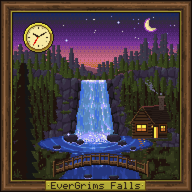 | `evergrims_falls` | 3x3 | the 90s lighted motion picture: only the water's light moves |
| 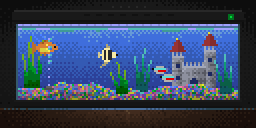 | `fish_tank` | 1x2 | desk toy: lit aquarium, fish and bubbles |
| 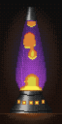 | `lava_lamp` | 2x1 | desk toy: lava lamp |
|  | `neon_closed` | 1x2 | neon CLOSED, fully lit |
| 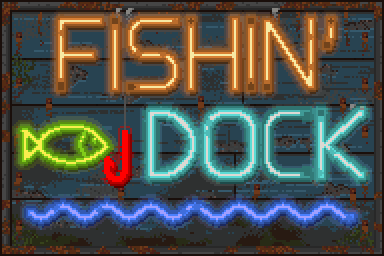 | `neon_fishin_dock` | 2x3 | neon FISHIN' DOCK, 50 years outdoors: lit, letters light up, flashes, off |
|  | `neon_open` | 1x2 | neon OPEN, fully lit |
|  | `neon_sushi` | 1x3 | neon Sushi with a nigiri, fully lit |
| 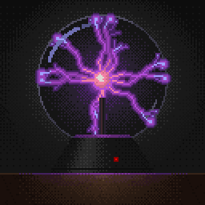 | `plasma_globe` | 2x2 | desk toy: plasma globe |

## Gallery

| Painting | Name | Size (HxW) |
|---|---|---|
| 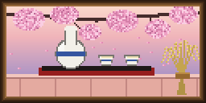 | `bar_cherry_blossom_sake` | 1x2 |
| 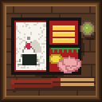 | `bar_dine_bento` | 1x1 |
| 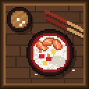 | `bar_dine_chirashi_miso` | 1x1 |
| 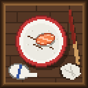 | `bar_dine_last_piece` | 1x1 |
| 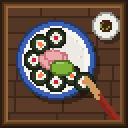 | `bar_dine_maki_ring` | 1x1 |
| 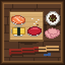 | `bar_dine_nigiri_board` | 1x1 |
| 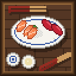 | `bar_dine_sashimi_for_two` | 1x1 |
| 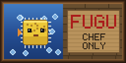 | `bar_fugu_warning` | 1x2 |
| 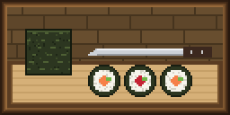 | `bar_kelp_maki` | 1x2 |
| 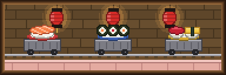 | `bar_minecart_kaiten` | 1x3 |
| 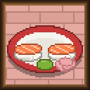 | `bar_plate_salmon_pair` | 1x1 |
| 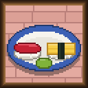 | `bar_plate_tuna_tamago` | 1x1 |
| 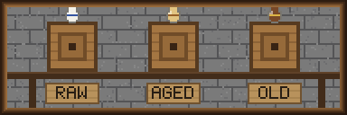 | `bar_sake_cellar` | 1x3 |
| 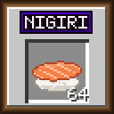 | `bar_slot_nigiri` | 1x1 |
| 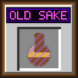 | `bar_slot_old_sake` | 1x1 |
|  | `bar_slot_onigiri` | 1x1 |
| 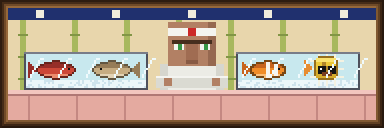 | `bar_villager_itamae` | 1x3 |
| 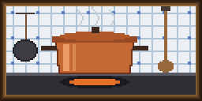 | `kitchen_copper_pot` | 1x2 |
| 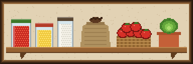 | `kitchen_harvest_shelf` | 1x3 |
| 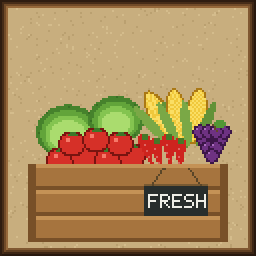 | `kitchen_market_crate` | 2x2 |
| 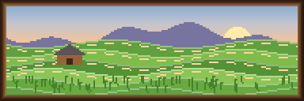 | `kitchen_rice_terraces` | 1x3 |
| 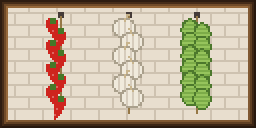 | `kitchen_ristra_garlic_hops` | 1x2 |
| 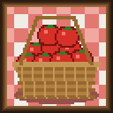 | `kitchen_tomato_basket` | 1x1 |
| 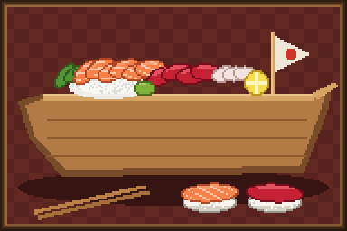 | `sushi_boat` | 2x3 |
| 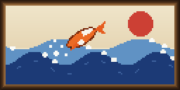 | `sushi_koi_wave` | 1x2 |
| 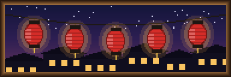 | `sushi_lantern_alley` | 1x3 |
| 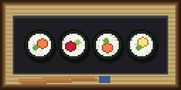 | `sushi_maki_platter` | 1x2 |
| 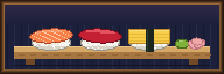 | `sushi_nigiri_trio` | 1x3 |
| 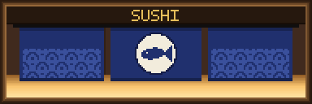 | `sushi_noren_curtain` | 1x3 |
| 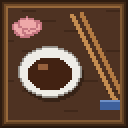 | `sushi_soy_chopsticks` | 1x1 |
